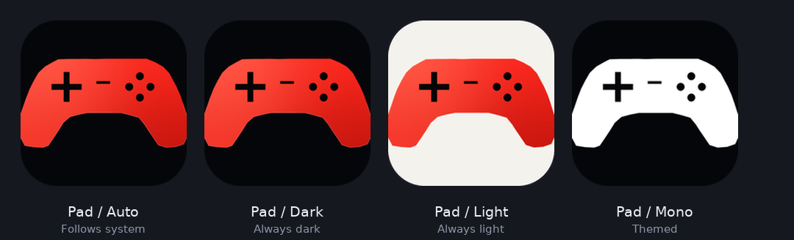

# GamersHub v6.25.1 — gamepad icon, light and dark

## 📲 Download

**https://github.com/official-hub-000/GamersHub/releases/download/v6.25.1/GamersHub-v6.25.1.apk**

| | |
|---|---|
| File | `GamersHub-v6.25.1.apk` — 24,635,966 bytes (23.5 MB) |
| Package | `com.gamershub` |
| Version | **6.25.1** (versionCode **95**) |
| Signing | APK Sig v2, release keystore |



---

## 1. The icon is the controller from the intro

The old mark was a faceted emblem you had to already recognise. The intro film
ends on a flat red controller, so the launcher is that controller now — one
chamfered silhouette, no curves, same 45°/90° language as the rest of the icon
set, and it reads at 48dp.

## 2. It follows the system theme

Four looks in **Likes ▸ Icon Look**. The default one is live:

| Look | What it does |
|---|---|
| **Pad / Auto** | plate is `@color/ic_pad_bg`, art is `@drawable/ic_pad_fg` — both have `-night` variants, so Android repaints the icon when the phone flips between light and dark. No code runs; it works with the app killed. |
| **Pad / Dark** | pins the dark plate |
| **Pad / Light** | pins the light plate |
| **Pad / Mono** | silhouette for launchers that theme icons |

Dark and light are drawn separately, not one drawing recoloured:

- **dark** keeps the ember bloom under the body and a lit lip along the lower
  silhouette, because the plate is nearly black and the icon has to glow
- **light** drops the bloom entirely — a glow reads as dirt on paper — and takes
  a hard ink edge instead

## 3. The rest of the app matches

The emblem is gone from the lobby hero card, the launch sheet, the floating
bubble and the status-bar notification icon. They all show the pad now, so the
thing on the home screen and the thing you tap inside the app are one object.

---

## Verified in the shipped APK

```
Signer SHA-256: 463c7264…c16e0
package: name='com.gamershub' versionCode='95' versionName='6.25.1'
expected: versionCode=95 versionName=6.25.1
not debuggable · media audit rc=0 · RESULT: PASS
```

Both build gates pass.

## What I did not ship, and why

v6.25.0 also carried a **Light or Dark** row for the app's own chrome. I pulled
it before this release: the app palette is a fixed warm near-black, so pressing
"Light" would have overridden the window background and changed almost nothing
visible. A control that looks like a switch and does nothing is worse than no
control, so the three icon modes carry the requirement — each one does exactly
what its label says.

If you want the app body itself to go light, that's a real piece of work: every
surface token (`GC.Bg`, `Surface`, `Text`, `TextDim`, `RomKit.Panel`…) needs a
light counterpart and every screen has to be walked to check contrast. Say the
word and I'll do it as its own release rather than bolt it onto the icon change.

## Reproducing the assets

`tools/pad_icon.py` generates every launcher asset from one geometry pass — four
adaptive descriptors, the night-aware foreground pair, five legacy bitmap
densities, the in-app pad mark and the settings previews:

```bash
python3 tools/pad_icon.py
```

The icon cannot drift between the launcher, the settings preview and the splash
because they are all the same function call.
