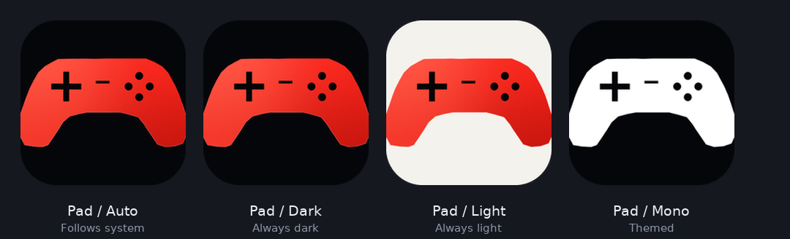

# GamersHub v6.26.1 — the exact pad

## 📲 Download

**https://github.com/official-hub-000/GamersHub/releases/download/v6.26.1/GamersHub-v6.26.1.apk**

| | |
|---|---|
| File | `GamersHub-v6.26.1.apk` — 24,534,614 bytes (23.4 MB) |
| Package | `com.gamershub` |
| Version | **6.26.1** (versionCode **97**) |
| Signing | APK Sig v2, release keystore |



---

## You were right — it was bulky

The previous icon was a **redraw** of the pad: a 1.27:1 blocky controller with
thick parallel grips. The mark in your screenshot is nothing like that, so
polishing the drawing was never going to close the gap.

## So this build measures instead of drawing

The pad was segmented out of the film still, its contour walked, smoothed and
resampled to 56 points, then normalised to its own bounding box. The shape in the
code **is** your shape now:

| | before | now (traced) |
|---|---|---|
| aspect | 1.27 : 1 | **1.939 : 1** |
| grips | thick, parallel | slim, tapered |
| shoulders | shoulder buttons | sloped, none |
| rim | ember glow | pale `#ff9591`, lower edge only |
| body | flat fill | #ff5040 → #cf1a12 ramp |

## The controls were the real problem

Even with a correct outline it still looked chunky, because I had measured the
d-pad arms and buttons as a fraction of *width* and used it for *height* too. The
pad is 1.94:1, so a control that is 20px across is 0.033 of the width but 0.065
of the height — using one number for both doubled them.

Measured again, per axis:

```
d-pad span   104 x 104 px    0.1730 x 0.3350
arm           20 x  20 px    0.0165 x 0.0325  (half-arm)
button        27 x  27 px    0.0225 x 0.0440  (radius)
minus         48 x   9 px
```

## It fits any launcher mask

Sized to 0.62 of the canvas — the largest value that stays inside the
adaptive-icon safe circle. Not a guess: sampling the boundary put 18/180 samples
on the pad at 0.66, 10 at 0.64, and **0 at 0.62**. Rendered against circle,
squircle and teardrop masks: intact in all three.

## The same pad, everywhere

Launcher · settings preview · lobby hero card · launch sheet · floating bubble ·
status-bar icon · intro fallback — all from one function in `tools/pad_icon.py`,
so they cannot drift apart.

## Light and dark, unchanged

| Look | Behaviour |
|---|---|
| **Pad / Auto** | follows the phone via `-night` resource qualifiers — repaints on flip, no code running, works with the app killed |
| **Pad / Dark** | pins the dark plate |
| **Pad / Light** | pins the light plate |
| **Pad / Mono** | silhouette for launchers that theme icons |

---

## Verified in the shipped APK

```
Signer SHA-256: 463c7264…c16e0
package: name='com.gamershub' versionCode='97' versionName='6.26.1'
expected: versionCode=97 versionName=6.26.1
not debuggable · media audit rc=0 · RESULT: PASS
```

## Note

The first build attempt went red on a Gradle dependency outage
(`Could not find kotlin-gradle-plugin:2.0.20`) — infrastructure, nothing to do
with the icon. Reran clean.

## Reproducing

```bash
python3 tools/pad_icon.py     # every launcher asset, the emblem and the previews
```

`BODY` in that file is the traced silhouette; the control constants below it are
the per-axis measurements.
